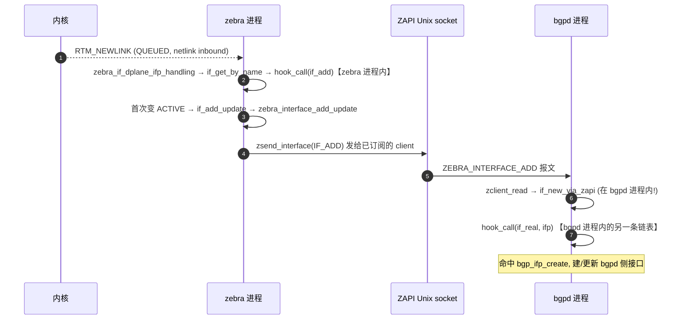
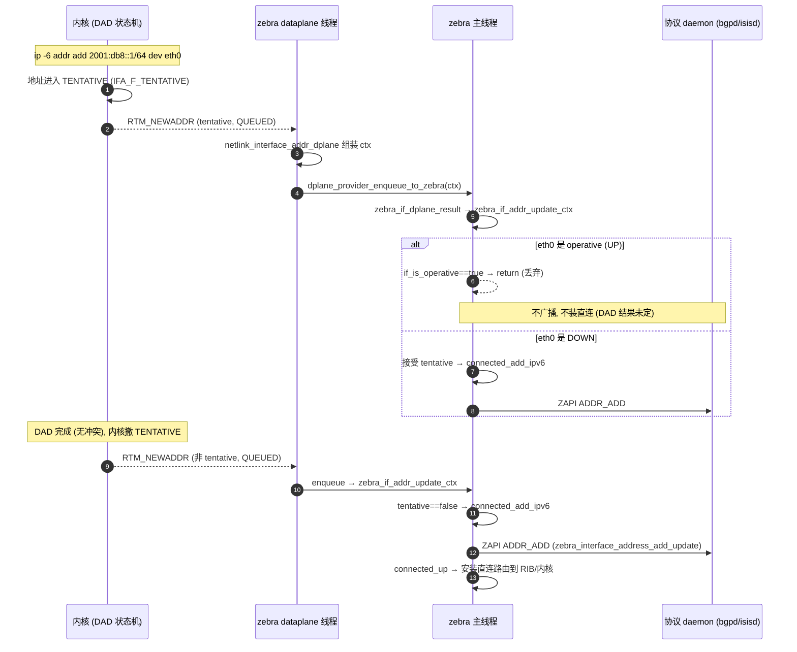
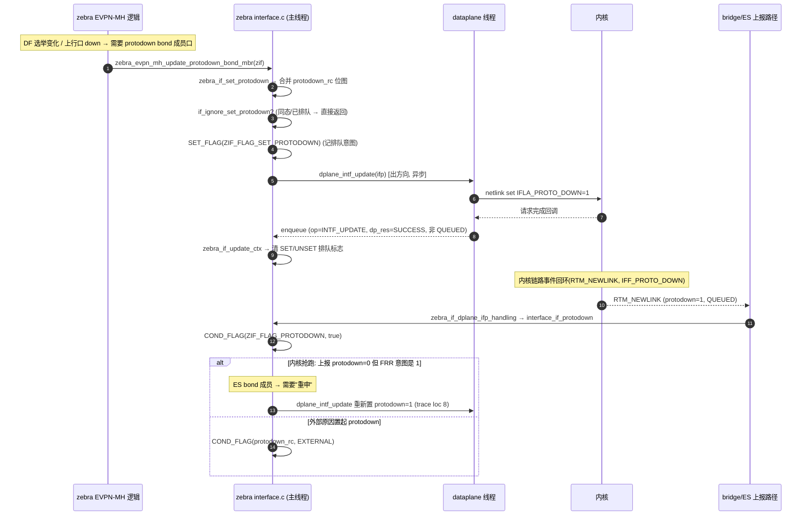
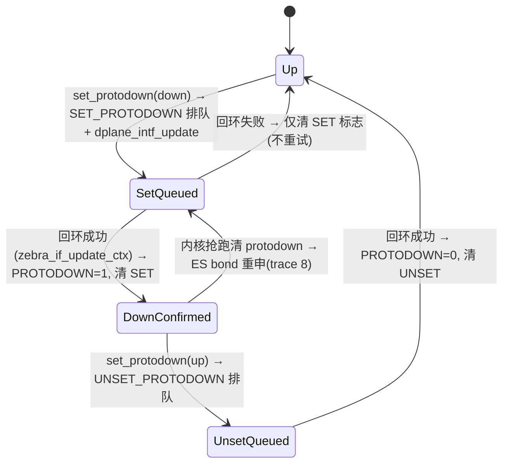

# FRR 接口（interface）事件全流程梳理

> 适用代码：`lib/if.c`、`zebra/interface.c`（配合 `zebra/if_netlink.c`、`zebra/connected.c`、`zebra/redistribute.c`、`zebra/zapi_msg.c`、`zebra/zebra_evpn_mh.c`、`zebra/zebra_l2.c`）。
> 目标：把"所有对 interface 的操作"从**事件源 → 入口 → 分发 → 副作用 → 协议广播/卸载**完整串通，并给出逐行级调用栈与时序图。

---

## 零、先建立方向感：两条主干路径

FRR 里所有接口操作最终都归到**两条方向相反的路径**，后面所有场景都是它们的排列组合。

```
【入方向 inbound：内核 → zebra → 协议】 "被动学习"
  内核 netlink socket (RTM_NEWLINK / RTM_DELLINK / RTM_NEWADDR / RTM_DELADDR)
     │ 运行在 dataplane 线程
     ▼
  netlink_link_change() / netlink_interface_addr_dplane()        ← if_netlink.c
     │ dplane_ctx_set_op(INTF_INSTALL / INTF_DELETE / ADDR_ADD / ADDR_DEL)
     │ dplane_ctx_set_status(ZEBRA_DPLANE_REQUEST_QUEUED)  ← 关键：QUEUED 代表"来自内核上报"
     ▼
  dplane_provider_enqueue_to_zebra(ctx)                          ← 投递到主线程
     ▼
  dg_results_cb → zebra_if_result → zebra_if_dplane_result(ctx)  ← interface.c:3001
     │ 按 op 分发 + 用 dp_res==QUEUED 区分 inbound / outbound 回环
     ▼
  zebra_if_dplane_ifp_handling() / zebra_if_addr_update_ctx() / zebra_if_update_ctx()
     │ 改 struct interface / struct connected
     ▼
  if_add_update / if_up / if_down / if_delete_update / if_handle_vrf_change
     ▼
  zebra_interface_*_update()  (redistribute.c) → ZAPI 报文 → 各协议 daemon
  + ctc_dplane_intf_event(ctx) → CTC 卸载层 → HSL 硬件


【出方向 outbound：配置 → zebra → 内核 → 回环】 "主动下发"
  vtysh 命令 / Northbound 回调
     ▼
  if_shutdown() / if_ip_address_install() / zebra_if_set_protodown() / ...   ← interface.c
     │ if_set_flags / dplane_intf_addr_set / dplane_intf_update
     ▼
  内核（真正执行 ioctl / netlink 下发）
     ▼
  内核产生 RTM_NEWLINK / RTM_NEWADDR 回环通知 → 又走【入方向】收敛
```

**核心心智**：zebra 对配置命令的处理**不是**直接告诉协议"接口 up 了"，而是"**改内核 → 等内核回环 → 回环再触发广播**"。因此下文每个 vtysh 场景都是"**配置动作** + **回环动作**"两段式。

### 0.1 事件源分类表

| 事件源 | 载体 | op / status | 入口函数 | 典型触发 |
|---|---|---|---|---|
| ① 内核 netlink（inbound） | `RTM_NEWLINK`/`DELLINK` | `INTF_INSTALL`/`INTF_DELETE` + `QUEUED` | `netlink_link_change` → `zebra_if_dplane_ifp_handling` | `ip link add/del/set`、拔插网线 |
| ① 内核地址 netlink | `RTM_NEWADDR`/`DELADDR` | `INTF_ADDR_ADD`/`DEL` + `QUEUED` | `netlink_interface_addr_dplane` → `zebra_if_addr_update_ctx` | `ip addr add/del`、SLAAC、DAD |
| ② 出方向请求回环结果 | dplane 完成回调 | `INTF_UPDATE` + 非 `QUEUED` | `zebra_if_update_ctx` | protodown 下发被内核确认 |
| ③ NB / CLI 配置 | mgmtd 事务 | — | `zebra_nb_config.c` 回调 → `if_*` | `interface X1`、`ip address`、`shutdown` |
| ④ 协议侧 ZAPI 接收 | daemon 收 zebra 报文 | — | `zclient_interface_*` → `if_*_via_zapi` | bgpd/isisd 学习接口 |
| ⑤ 定时器 | event | — | `if_zebra_speed_update` | 速率轮询 |

### 0.2 六个钩子事件（消费端，`lib/if.c` 定义）

| 钩子 | 语义 | 触发者 | 顺序 | 注册者举例 |
|---|---|---|---|---|
| `if_add` | 接口对象创建 | `if_create_name()` | 正序 `DEFINE_HOOK` | zebra `if_zebra_new_hook`、bgp、isis |
| `if_del` | 接口对象销毁 | `if_delete_retain()` | 逆序 `DEFINE_KOOH` | zebra `if_zebra_delete_hook` |
| `if_real` | 内核里真实存在 | `if_new_via_zapi()` | 正序 | isis、bgp `*_ifp_create` |
| `if_unreal` | 内核里消失 | `if_destroy_via_zapi()` | 逆序 | `*_ifp_destroy` |
| `if_up` | operative 变 up | `if_up_via_zapi()` | 正序 | bgp `bgp_ifp_up`、babel |
| `if_down` | operative 变 down | `if_down_via_zapi()` | 逆序 | `*_ifp_down` |

> ⚠️ `if_real/if_unreal/if_up/if_down` 这四个钩子**绝不在 zebra 进程内触发**（`lib/if.h:409-425` 明确注释）。zebra 内部用 `if_up()`/`if_down()` 函数直接处理；钩子是给**别的 daemon** 用的。`DEFINE_KOOH` = 逆序调用（卸载顺序与注册相反）。

---

## 一、内核 `ip link` 事件（inbound）

在 shell 里敲 `ip ...` 或拔网线，即 zebra 之外的程序改动内核接口。内核通过 netlink multicast group 主动推送，zebra 的 dataplane 线程收到后走【入方向】。

### 场景 1：`ip link add X1 type vxlan ...`（新建接口）

```
内核 RTM_NEWLINK (family=AF_UNSPEC, 携带 IFLA_LINKINFO kind=vxlan)
 └─ netlink_link_change()                     if_netlink.c:1867
     ├─ op=DPLANE_OP_INTF_INSTALL, status=QUEUED     :2061
     ├─ 解析 name/ifindex/mtu/flags/master/tableid 填 ctx
     ├─ netlink_interface_update_l2info(add=1) 提取 vxlan 隧道信息  :2172
     └─ dplane_provider_enqueue_to_zebra(ctx)  ────────► 主线程

zebra_if_dplane_result(ctx)                  interface.c:3001
 ├─ zns = zebra_ns_lookup(ns_id); ifp = if_lookup_by_index_per_ns(ifindex)
 ├─ op==INTF_INSTALL && dp_res==QUEUED
 ├─ ctc_dplane_intf_event(ctx)   ← 先转发卸载层(此时 ifp/zif_type 未被重置)  :3088
 └─ zebra_if_dplane_ifp_handling(ctx)          :2441
     └─ ifp==NULL →【新增接口分支】:2590
         ├─ ifp = if_get_by_name(name, vrf_id)  ← hook if_add → if_zebra_new_hook
         ├─ set_ifindex(ifp, ifindex, zns)      ← 撞名=改名,见场景 4
         ├─ ifp->flags = flags; 更新 mtu/speed/metric/txqlen
         ├─ zebra_if_set_ziftype(VXLAN) → zebra_evpn_if_init
         ├─ zebra_if_update_link(link_ifindex)  ← 父口没到留 NULL 待 fixup
         ├─ interface_update_hw_addr(MAC)
         ├─ if_add_update(ifp)  ★ 见第四节
         ├─ interface_update_l2info(add=1) → zebra_l2_vxlanif_add_update  :2088
         └─ protodown_set? → interface_if_protodown / startup → if_sweep_protodown
```

### 场景 2：`ip link del X1`（删除接口）

```
内核 RTM_DELLINK
 └─ netlink_link_change(): op=INTF_DELETE, status=QUEUED   :2185
zebra_if_dplane_result(): ctc_dplane_intf_event(ctx) 先转发(ifp/zif_type 仍有效)
 └─ zebra_if_dplane_ifp_handling(): ifp 存在 →【删除接口分支】:2468
     ├─ IS_BOND?          zebra_l2if_update_bond(false)
     ├─ IS_BOND_SLAVE?    zebra_l2if_update_bond_slave(false)
     ├─ IS_BRIDGE?        zebra_l2_bridge_del ;  IS_VXLAN? zebra_l2_vxlanif_del
     ├─ if_delete_update(&ifp)  ★ 见第五节
     └─ zif_type==VRF && !netns → interface_vrf_change(DELETE) → vrf_delete
```

### 场景 3：`ip link set eth0 down` / 拔网线（flags 变化）

"端口 up/down" 最原始的来源。内核仍发 **RTM_NEWLINK**（不是 DELLINK），只是 `ifi_flags` 里 `IFF_RUNNING`/`IFF_UP` 变了，`ifi_change` 掩码指明改了哪些位。

```
内核 RTM_NEWLINK (flags 变化)
 └─ op=INTF_INSTALL, status=QUEUED; ctx 带新 flags + change_flags(=ifi_change)
zebra_if_dplane_ifp_handling(): ifp 已存在且 ACTIVE 且 vrf 没变
 └─【普通接口更新分支】:2727  ★ up/down 四态判定,见第三节
     ├─ 若 change_flags==IFF_PROMISC → 只更新 flags 后 return(抑制虚假路由更新) :2761
     ├─ set_ifindex / mtu / mac / link / protodown 更新
     ├─ if (if_is_no_ptm_operative 当前) { ... 判是否转 DOWN 或保持 UP ... }
     ├─ else { ... 判是否转 UP ... }
     ├─ if_down(ifp) + rib_update(RIB_UPDATE_KERNEL)   ★
     │   或 if_up(ifp, is_up)                          ★
     └─ interface_update_l2info(add=0) + bridge/bond 联动
```

> 注意：`zebra_if_dplane_result()` 里对 `INTF_UPDATE` 且**非 QUEUED** 的 ctx 会走 `zebra_if_update_ctx()`（interface.c:1660），那是**出方向 protodown 请求的完成回环结果**，不是这里的内核主动上报，别混淆。

---

## 二、vtysh `interface X1` + 配置 IP 地址（两段式）

### 阶段 A：`configure terminal` → `interface X1`

```
vtysh 命令 → NB 事务 → lib_interface_create(NB_EV_APPLY)   lib/if.c:1541
 └─ ifp = if_get_by_name("X1", VRF_UNKNOWN, vrfname)
     └─ if_create_name → if_new + if_set_name + hook_call(if_add)
         └─ if_add → if_zebra_new_hook()   interface.c:176
             ├─ 分配 struct zebra_if, 三态配置=UNSPEC
             ├─ nhg 依赖树 / PTM / rtadv / EVPN-MH / ipv4_subnets 树初始化
             └─ event_add_timer(if_zebra_speed_update, 15s) 延后测速
 ifp->configured = true    ★关键
```

⚠️ **此刻 X1 是一个"伪接口"**：`ifindex==IFINDEX_INTERNAL`，`status` 里**没有** `ZEBRA_INTERFACE_ACTIVE`。即 vtysh 只是建了配置壳子，内核里不一定有这个口，也不会给协议广播 IF_ADD。真正广播要等内核侧该口存在并被 dump/事件上报（场景 1）时才发生。

### 阶段 B：`ip address 192.0.2.1/24`

```
vtysh → NB 回调 zebra_nb_config.c → if_ip_address_install(ifp, prefix, label)  interface.c:4779
     ① connected_check_ptp 复用或新建 struct connected
     ② SET_FLAG(ifc->conf, ZEBRA_IFC_CONFIGURED)   ← 标记"用户配的"
     ③ 仅当【未QUEUED && 接口ACTIVE && 未shutdown】才真正下发:
         if (!if_is_up) { if_set_flags(IFF_UP|IFF_RUNNING); if_refresh; }
         dplane_intf_addr_set(ifp, ifc)   ← 出方向:向内核加地址
         SET_FLAG(ifc->conf, ZEBRA_IFC_QUEUED)
```

- 若 X1 还是阶段 A 的伪接口（非 ACTIVE），③ 整段跳过——地址只记 CONFIGURED，等接口将来激活时由 `if_addr_wakeup()` 补下发。

### 阶段 C：内核加地址成功后回环（inbound）

```
内核 RTM_NEWADDR → netlink_interface_addr_dplane()   if_netlink.c:1520
   op=INTF_ADDR_ADD, status=QUEUED, 填 addr/dest/label/metric/tentative…
   └─ dplane_provider_enqueue_to_zebra
zebra_if_dplane_result(): op==INTF_ADDR_ADD → zebra_if_addr_update_ctx()  interface.c:1539
 ├─ tentative IPv6 策略(UP 口跳过, DOWN 口接受)   :1568   ★见"逐行级场景一"
 ├─ 组装 flags: PEER/SECONDARY/NOPREFIXROUTE, label, metric
 ├─ connected_add_ipv4()   connected.c:358
 │   └─ connected_update → connected_announce():   connected.c:57
 │       ├─ if_connected_add_tail(挂到接口地址链)
 │       ├─ v4: if_subnet_add(主/次地址判定)      interface.c:370
 │       ├─ zebra_interface_address_add_update()  ← ZAPI ADDR_ADD 广播给所有协议 ★
 │       └─ 若 if_is_operative → connected_up()   ← 安装直连路由到 RIB/内核
 └─ 若 op 是 DEL → rib_update(RIB_UPDATE_KERNEL)  (内核 down 时不发路由删除,需补处理)
```

**一句话总结**：`interface X1`（建伪接口，configured=true，不广播）→ `ip address`（标 CONFIGURED；接口 ACTIVE 才下发内核）→ 内核回环 NEWADDR（真正建 connected、挂子网链、广播 ADDR_ADD、装直连）。三段缺一不可，且顺序不能反。

---

## 三、端口 up/down 的完整判定与副作用

### 3.1 四态决策真值表（interface.c:2816-2927）

判定用两个谓词：`if_is_no_ptm_operative()`（不含 PTM）与 `if_is_operative()`（含 PTM+LOWER_UP+link-detect），再叠加 `ZIF_FLAG_PROTODOWN`。

| 当前 no_ptm_operative | 新 flags 下 operative | PROTODOWN | 动作 | trace loc |
|---|---|---|---|---|
| 是(现在算 up) | 变不 operative **或** PROTODOWN 置位 | — | `if_down(ifp)` + `rib_update(KERNEL)` | 1 |
| 是 | 仍 operative | 未置 | `if_up(ifp, is_up)`；再查 MAC 变化→SVI/bridge 联动 | 2 |
| 否(现在 down) | 变 operative 且未 PROTODOWN | 未置 | `if_up(ifp, true)`；bridge 置 MASTER_UP | 4 |
| 否 | 仍不 operative 或 PROTODOWN | — | `if_down(ifp)` + `rib_update(KERNEL)` | 5 |

> `if_is_operative` 定义（`lib/if.c:789`）：`IFF_UP && ((IFF_RUNNING && IFF_LOWER_UP && (ptm通过||ptm未启用)) || 未启用link-detect)`。所以 **link-detect 关闭时**只要 `IFF_UP` 就算 operative——这解释了为什么"shutdown"和"拔线"在某些配置下行为不同。

### 3.2 `if_up()` 全部副作用（interface.c:1160-1239）

```
if_up(ifp, install_connected):
 1. zif->up_count++ / 记时间戳
 2. PTM 使能但 ptm_status==DOWN → 直接 return(不广播,等 PTM 就绪)   ★抑制
 3. zebra_interface_up_update()   ← ZAPI IF_UP 广播给协议
 4. if_nbr_ipv6ll_to_ipv4ll_neigh_add_all()  ← RFC5549 重建 v4ll 邻居
 5. rtadv_if_up()   ← 启 IPv6 RA
 6. install_connected? if_install_connected()  ← 重发地址 ADD + connected_up 装直连
 7. zebra_interface_nhg_reinstall()  ← 重同步 down 期间被撤的 nhg
 8. EVPN/VxLAN 按类型: vxlan_if_up / svi_up / macvlan_up
 9. ES 运行态变更(up) / MH 上行口 oper update
10. event_add_timer(if_zebra_speed_update, 0)  ← 立即重测速率
11. if_addr_wakeup()  ← 补装 pending 地址
12. if_handle_bond_speed_change()  ← bond 带宽联动
13. rib_update_handle_vrf_all(RIB_UPDATE_KERNEL)  ← 内核路由重选
```

### 3.3 `if_down()` 全部副作用（interface.c:1248-1310）

```
if_down(ifp):
 1. zif->down_count++ / 记时间戳
 2. rtadv_stop_ra(ifp,true)   ← 停 RA(lifetime=0)
 3. if_down_nhg_dependents()  ← 通知依赖 nhg 重新判有效性
 4. EVPN/VxLAN 净化: vxlan_if_down / svi_down / macvlan_down(远程邻居表项)
 5. ES 运行态(down) / MH 上行口 oper update
 6. zebra_interface_down_update()   ← ZAPI IF_DOWN(内部还 zebra_neigh_del_all)
 7. if_uninstall_connected()  ← 逐地址广播 ADDR_DEL + connected_down 撤直连(地址对象保留)
 8. if_nbr_ipv6ll_to_ipv4ll_neigh_del_all()  ← 删 v4ll 映射
 9. if_down_del_nbr_connected()  ← 删 RA 学到的邻居地址
10. if_handle_bond_speed_change()
11. rib_update_handle_vrf_all(RIB_UPDATE_INTERFACE_DOWN)  ← 触发路由重选
```

---

## 四、`if_add_update()`：接口激活枢纽（interface.c:650-726）

内核学到接口（场景 1）或速率变化时调用：

```
if_add_update(ifp):
 1. zebra_ns_link_ifp(zns,ifp)  挂入 NS 容器(VRF 没使能退回 NS_DEFAULT)
 2. multicast 三态==ON/OFF 覆盖 IFF_MULTICAST
 3. zebra_ptm_if_set_ptm_state
 4. zebra_interface_add_update()  ← ZAPI IF_ADD 广播给所有协议 ★
 5. IS_DUMMY → 置 ZEBRA_INTERFACE_DUMMY
 6. 首次变 ACTIVE(之前没有 ACTIVE 标志):
      SET_FLAG(ACTIVE)
      if shutdown==ON → 直接 return(trace loc 2, 不拉起)
      else if_addr_wakeup()  ← 补装 CONFIGURED 未 QUEUED 的地址
      mpls_config==ON/OFF → dplane_intf_mpls_modify_state
 7. trace loc 1
```

---

## 五、接口删除 `if_delete_update()`（interface.c:876-956）

`ip link del`（场景 2）与改名（场景 4）都收敛到这里。顺序极讲究：

```
if_delete_update(&ifp):
 0. if_is_up(ifp)? → 报错拒绝(防误删), return
 0. 已 !ACTIVE? → 幂等 return
 1. UNSET_FLAG(ACTIVE)  (trace loc 0)
 2. if_delete_connected(ifp)  ← v4 按子网链"先次后主"删, v6 逐个; connected_down +
                                  显式补发 ADDR_DEL(因为先销毁 ifc 收不到内核通知)
 3. vrf-lite 后端且 vrf_id!=0 → if_handle_vrf_change(ifp, VRF_DEFAULT)(搬回默认 VRF)
 4. zebra_interface_delete_update()  ← ZAPI IF_DEL 广播(此刻 ifindex 仍有效)
 5. zebra_ns_unlink_ifp(ifp)
 6. if_set_index(IFINDEX_INTERNAL)   ← 广播后才清 ifindex(留旧值给客户端收尾)
 7. UNSET VRF_LOOPBACK 标志
 8. 复位 zif: evpn cleanup, type=OTHER, memset l2info/brslave, mac del
 9. if (!ifp->configured) if_delete(pifp)  ← 无用户配置才真正释放对象 ★
      (若 vtysh 还配着这个口 → 保留对象退回"伪接口", 等内核再报回来复用)
```

### 场景 4：接口改名（ifindex 复用，`set_ifindex` interface.c:1983）

```
set_ifindex(ifp, new_index, zns)
 oifp = if_lookup_by_index_per_ns(new_index)   ← 新 ifindex 已被别的对象占用?
 if 占用且是保留内部值(IFINDEX_INTERNAL) → 只报错
 else 视为改名:
    if if_is_up(oifp) → 报错"up 口改名,结果不可靠"
    if_delete_update(&oifp)   ← 旧名字对象走完整删除流程
 if_set_index(ifp, new_index)
```

---

## 六、vtysh 配置命令 → 函数映射表

| vtysh 命令 | NB→函数 | 函数动作 | 后续 |
|---|---|---|---|
| `shutdown` | `if_shutdown()` :4689 | 有真实 ifindex：先 `rtadv_stop_ra(lifetime=0)` 再 `if_unset_flags(IFF_UP)`；记 `shutdown=ON` | 内核回环 RTM_NEWLINK(UP 清)→ if_down；接口重现时 `if_add_update` 见 `shutdown==ON` 不再拉起 |
| `no shutdown` | `if_no_shutdown()` :4713 | `if_set_flags(IFF_UP\|IFF_RUNNING)` + `if_addr_wakeup()`（补被 down 移走的 v6 地址）；记 `shutdown=OFF` | 内核回环 UP → if_up |
| `link-detect` | `if_linkdetect()` :4659 | 设/清 `ZEBRA_INTERFACE_LINKDETECTION`；切换后若 operative 翻转**当场**调 if_down/if_up | 直接产生广播（不等回环） |
| `multicast`/`no` | `if_multicast_set/unset()` :4615/4636 | ACTIVE 才动 `IFF_MULTICAST`；无论是否 ACTIVE 都记三态 `multicast=ON/OFF` | 下次 `if_add_update` 依三态重新应用 |
| `arp`/`no arp` | `if_arp()` :4592 | ACTIVE 时置/清 `IFF_NOARP` | 仅记日志不回滚 |
| `ip address` | `if_ip_address_install()` :4779 | 见第二节阶段 B/C | NEWADDR 回环收敛 |
| `ipv6 address` | `if_ipv6_address_install()` :4873 | 同 IPv4 但无 label/点对点 | 同 NEWADDR 回环 |
| protodown(EVPN/VRRP) | `zebra_if_set_protodown()` :1515 | 合并原因位图 → `dplane_intf_update`(出向) | 回环 `zebra_if_update_ctx` 收敛 |

---

## 七、VRF 归属变更（两个层面，别混淆）

### 7.1 成员口迁 VRF —— `if_handle_vrf_change()`（interface.c:963）

```
1. 记住 old_vrf_id
2. if_uninstall_connected()   ← 撤旧 VRF 全部直连
3. if_nbr_ipv6ll_to_ipv4ll_neigh_del_all() + if_down_del_nbr_connected()
4. zebra_interface_vrf_update_del()   ← 向旧 VRF 发 IF_DEL
5. if if_is_vrf(ifp) → return(VRF 设备本身到此为止, 协议自行重建)
6. if_update_to_new_vrf(ifp, vrf_id)  ← lib/if.c: 从旧 VRF 两棵树摘除→挂新 VRF+重建 state
7. zebra_interface_vrf_update_add()   ← 向新 VRF 发 IF_ADD
   (协议侧视图 = "旧接口消失 + 新接口出现")
```
触发点：`zebra_if_dplane_ifp_handling` 的【VRF 变更分支】(interface.c:2708，判定 `ifp->vrf->vrf_id != vrf_id`)。

### 7.2 VRF 设备生命周期 —— `interface_vrf_change()`（interface.c:1884）

```
ip link add CUST1 type vrf table 100 → RTM_NEWLINK, zif_type=VRF
 ├─ DELETE: vrf_lookup_by_id(ifindex) → vrf_delete
 └─ ADD/UPDATE:
     tableid 冲突检查(同表 id 映射到不同 VRF = 配置错误 → frr_exit 退出!)  :1932
     vrf = vrf_update(ifindex, name)   创建/刷新 VRF 对象
     zvrf->table_id = tableid   ★必须先于 vrf_enable(否则延迟装的静态路由拿错表)
     vrf_enable(vrf)   激活(触发延迟静态路由等 enable 回调)
```

---

## 八、protodown（协议性 down，链路物理仍 up）

出方向，唯一走 `dplane_intf_update()` 的路径。典型发起者：EVPN-MH / MLAG / VRRP。详见"逐行级场景二"。

```
zebra_if_set_protodown(ifp, down, reason)   interface.c:1515
 └─ 按位 OR/AND-NOT 合并 protodown_rc 位图 → zebra_if_update_protodown_rc()  :1477
     ├─ if_ignore_set_protodown 去重(同态/已在队列则 return 1)   :1396
     ├─ 写 protodown_rc, 置 ZIF_FLAG_SET/UNSET_PROTODOWN(排队标志)
     └─ dplane_intf_update(ifp)  ← 出方向下发内核

 ┌── 内核执行后回环(RTM_NEWLINK, 非 QUEUED) ──┐
 zebra_if_dplane_result(): INTF_UPDATE && dp_res != QUEUED → zebra_if_update_ctx()  :1660
   ├─ 失败 → 只清 SET/UNSET 排队标志(允许后续新请求), 不重试
   └─ 成功 → COND_FLAG(ZIF_FLAG_PROTODOWN, down) 对齐内核真实值 + 清排队标志

 ┌── 内核自主/外部引起的 protodown 上报(QUEUED inbound) ──┐
 zebra_if_dplane_ifp_handling → interface_if_protodown()   :2131
   ├─ 非 FRR 单方面原因 → 记 ZEBRA_PROTODOWN_EXTERNAL 位
   ├─ 状态真变化 → COND_FLAG(ZIF_FLAG_PROTODOWN)
   └─ 若本口是 ES bond 成员: 内核抢跑清了 protodown → 把旧意图"重申"重新排入 dplane
```

---

## 九、二层联动事件（AF_BRIDGE 特殊分流）

`bridge`/`vxlan` 的 VLAN 属性走**独立地址族 AF_BRIDGE**：

```
内核 AF_BRIDGE RTM_NEWLINK → netlink_link_change: op=INTF_INSTALL, 转 netlink_bridge_interface
 → zebra_if_dplane_ifp_handling: family==AF_BRIDGE → interface_bridge_handling()  :2397
     ├─ IS_VXLAN → interface_bridge_vxlan_update(): SVD 刷 VLAN-VNI 映射表 + 取 PVID 作接入 VLAN  :2318
     └─ 其他且自身维护 vlan_bitmap → interface_bridge_vlan_update(): 重建 VLAN 位图(range 展开)  :2352
```
父口/成员映射因内核 dump 不保证"先下层后上层"，全量 dump 结束后由 `zebra_if_update_all_links()`（interface.c:1385）遍历做 fixup（bond 成员→bond、SVI/子口 link→父口、VLAN↔SVI EVPN 映射）。

---

## 十、协议侧钩子：`if_*` 三对事件（消费端）

前面所有 `zebra_interface_*_update()` 发出的 ZAPI 报文，在 daemon 侧由 `lib/zclient.c` 收，再触发 `lib/if.c` 的钩子：

| zebra→daemon ZAPI | daemon 收到后调用 | 触发钩子 | 谁注册（举例） |
|---|---|---|---|
| `ZEBRA_INTERFACE_ADD` | `if_new_via_zapi()` | `if_real` | bgp `bgp_ifp_create`、isis、bfdd |
| `ZEBRA_INTERFACE_UP` | `if_up_via_zapi()` | `if_up` | bgp `bgp_ifp_up`、babel、eigrp |
| `ZEBRA_INTERFACE_DOWN` | `if_down_via_zapi()` | `if_down` | 同上 `*_ifp_down` |
| `ZEBRA_INTERFACE_DELETE` | `if_destroy_via_zapi()` | `if_unreal` | `*_ifp_destroy` |
| 对象创建/销毁（本地） | — | `if_add`/`if_del` | zebra/bgp/isis/babel 的 `*_new_hook`/`*_delete_hook` |

### 10.1 钩子机制原理：进程内回调链 vs 跨进程 ZAPI（重要辨析）

> 最容易搞混的一点：`hook_call(if_add, ifp)` **不会**通知其它进程。它是**纯进程内**的"函数指针链表遍历"。其它 daemon（bgpd/isisd…）收到接口信息靠的是另一套完全不同的机制——**ZAPI Unix 套接字**。

#### 10.1.1 `DEFINE_HOOK` 展开后是什么

看 `lib/hook.h:210-234` 的 `DEFINE_HOOK_INT`，`DEFINE_HOOK(if_add, (struct interface *ifp), (ifp))` 编译后生成**两样东西**：

```c
/* ① 一个全局变量：链表头 */
struct hook _hook_if_add = {
        .name = "if_add", .entries = NULL, .reverse = false,
};

/* ② 一个 static 函数：遍历链表逐个调用 */
static int hook_call_if_add(struct interface *ifp)
{
        int hooksum = 0;
        struct hookent *he = _hook_if_add.entries;   /* 链表头 */
        ...
        for (; he; he = he->next) {                  /* 遍历 */
                hookp.voidptr = he->hookfn;          /* 取函数指针 */
                hooksum += hookp.fptr(ifp);          /* 调用它, 返回值累加 */
        }
        return hooksum;
}
```

它维护的只是一个**注册回调链表**（观察者模式），跟信号、socket 一点关系都没有。`struct hook`（`hook.h:114`）含 `entries`（链表）与 `reverse`（是否逆序）。

```
_hook_if_add (struct hook)
   ├─ name = "if_add"
   ├─ reverse = false
   └─ entries ──► hookent ──► hookent ──► hookent ──► NULL
              (prio=0,     (prio=1000,  (prio=1999,
               if_zebra_     bgp_if_      module_x_)
               new_hook)     new_hook)
```

#### 10.1.2 `hook_register_prio`：按优先级插入链表节点

`hook_register_prio(if_add, 0, if_zebra_new_hook)` 展开后调 `_hook_register()`（`lib/hook.c:17-44`），核心是按 `priority` **排序插入**：

```c
for (pos = &hook->entries; *pos; pos = &(*pos)->next)
        if (hook->reverse ? (*pos)->priority < priority
                          : (*pos)->priority >= priority)
                break;
he->next = *pos;
*pos = he;
```

- 数值越**小**越靠**前**调用；`DEFINE_KOOH`（`reverse=true`）相反——用于清理类钩子（`if_del`/`if_unreal`/`if_down`）保证"注册正序、注销逆序"。
- 每个节点存 **函数指针** + 可选附加参数 `hookarg`（`hook_register_arg`）+ 优先级。默认 `HOOK_DEFAULT_PRIORITY=1000`。
- 注册时机都在各模块 `xxx_init()` 里，如 `zebra_if_init()`（interface.c:4949）的 `hook_register_prio(if_add, 0, if_zebra_new_hook)`。
- **类型安全**靠 `DECLARE_HOOK` 生成的 `static inline _hook_typecheck_if_add(...)`：注册的函数签名不对则编译期报错。

#### 10.1.3 `hook_call`：调用点在 `lib/if.c`，同进程

`if_create_name()`（lib/if.c:311）里的 `hook_call(if_add, ifp)` 就是 `hook_call_if_add(ifp)`，**同进程的一次普通函数调用**，遍历链表把 `if_zebra_new_hook(ifp)`、`bgp_if_new_hook(ifp)` 等挨个 call 一遍。

#### 10.1.4 最关键：每个进程各有一份 `_hook_if_add`

`libfrr` 是**共享库**，`_hook_if_add` 是它的全局变量。FRR 是多进程架构（zebra、bgpd、isisd 各独立进程），**每个进程各自链接 libfrr、各持一份独立的 `_hook_if_add` 和独立的接口对象表**：

```
┌─────────── zebra 进程 ───────────┐   ┌─────────── bgpd 进程 ───────────┐
│  _hook_if_add (zebra 私有副本)   │   │  _hook_if_add (bgpd 私有副本)   │
│   └─ if_zebra_new_hook           │   │   └─ bgp_if_new_hook            │
│  if 对象表 (zebra 私有)          │   │  if 对象表 (bgpd 私有)          │
│   └─ X1, eth0, ...               │   │   └─ X1, eth0, ...              │
│  hook_call(if_add) 只遍历上面这条 │   │  hook_call(if_add) 只遍历这条    │
└──────────────────────────────────┘   └──────────────────────────────────┘
      ▲ 两个链表在内存里毫无关联，跨进程不可见
```

所以：**zebra 里 `hook_call(if_add)` 绝不会调到 bgpd 的任何函数**。

#### 10.1.5 钩子 vs ZAPI 对比表

| | 钩子 hook | ZAPI |
|---|---|---|
| 边界 | **同一进程内**的回调链表 | **跨进程** Unix 套接字 |
| 触发 | `hook_call(...)` | `zsend_interface(...)` → client `zclient` 收包 |
| 数据 | 直接传 `struct interface *` 指针 | 序列化成字节流报文 |
| 谁收到 | 只在**调用它的那个进程**注册过的回调 | 所有连着 zebra 且订阅了接口更新的 daemon |

精妙之处：**每个 daemon 进程内部也用钩子**，只是是它自己那一份链表。`if_real`/`if_up` 钩子在 bgpd 进程里由 `if_new_via_zapi`/`if_up_via_zapi` 触发，从而 call 到 bgpd 自己注册的 `bgp_ifp_create`/`bgp_ifp_up`。这正是前文"`if_real/if_unreal/if_up/if_down` 四个钩子**绝不在 zebra 进程内触发**"的根因——它们在 daemon 侧由 ZAPI 接收路径触发。

> ⚠️ **重要辨析（修正一个常见误解）**：“配置 `interface X1` 只进 zebra”是**错误**的。在 mgmtd 模型下，`/frr-interface:lib/interface` 这条 XPath 被 **zebra 和所有加载了 `frr_interface_info`（带 `.create` 回调）的 daemon** 同时订阅（bgpd/isisd/ospfd/pimd/staticd/bfdd…），因此 **每个 daemon 都会收到自己的那份 CFG_REQ、并在自己进程里跑 `lib_interface_create` → `hook_call(if_add)`**。下面两张图分别展示“配置路径”与“内核路径”。

#### 10.1.6 两条“造接口对象”的路径（两张时序图）

**（1）配置路径：vtysh `interface X1` → mgmtd 广播给**所有**订阅该 XPath 的 provider（各自进程内触发 `if_add`）：**

```mermaid
sequenceDiagram
    autonumber
    participant V as vtysh
    participant M as mgmtd
    participant Z as zebra 进程
    participant B as bgpd 进程
    participant I as isisd 进程

    V->>M: 配置事务 "interface X1" (setcfg + commit)
    M->>M: 按 XPath 查订阅位掩码<br/>mgmt_be_interested_clients() = zebra|bgpd|isisd...
    par 广播给每个订阅者(各发一份 CFG_REQ)
        M->>Z: CFG_REQ create
        Z->>Z: lib_interface_create NB_EV_APPLY → if_create_name → hook_call(if_add)
        Note over Z: 命中 if_zebra_new_hook, 分配 struct zebra_if
    and
        M->>B: CFG_REQ create
        B->>B: lib_interface_create → hook_call(if_add)【bgpd 自己链表】
        Note over B: 命中 bgp_if_new_hook, 建 bgpd 侧接口对象
    and
        M->>I: CFG_REQ create
        I->>I: lib_interface_create → hook_call(if_add) → isis 侧回调
    end
    Note over Z,B,I: 各进程的 hook_call(if_add) 互不跨进程,但都被各自触发了一次
    Note over Z: X1 仍是"伪接口"(ifindex=INTERNAL, 非 ACTIVE)<br/>zebra 不因此下发内核, 也不发 ZAPI IF_ADD
```

**（2）内核路径：接口在内核里凭空出现（`ip link add`/物理网卡）→ 只有 zebra 先学到 → ZAPI 告知各 daemon（触发 `if_real`）：**



> 两条路径的区别：配置路径由 **mgmtd 广播**、直接在各 daemon 触发 `if_add`；内核路径由 **zebra 经 ZAPI**、在 daemon 侧触发的是 `if_real`。两者最终都汇聚到同一个 `struct interface` 对象的 `ACTIVE`/`ifindex`/`flags` 状态上。

**结论（直接回答“配置 interface X1 时其它每个模块进程都会收到吗”）：**

1. `hook_call(if_add)` 本身**不跨进程**（一个进程里的钩子调用绝不会调到另一个进程的函数）。
2. **但**在 mgmtd 模型下，`interface X1` 这条配置**会广播给所有订阅 `/frr-interface:lib/interface` 的后端**（zebra + 各协议 daemon），**每个进程各自独立**跑 `lib_interface_create` → `hook_call(if_add)`。所以 bgpd/isisd 在配置下发时**就能感知**（不是“无感知”，也不是靠 ZAPI）。
3. 只有**内核侧凭空出现的口**才需要靠 ZAPI `IF_ADD`（daemon 侧触发 `if_real`）来告知。
4. 伪接口阶段（仅 `interface X1`）：各进程建了对象但未 `ACTIVE`；真正驱动内核同步/广播 `IF_ADD`/up-down 的仍然**只有 zebra**（因为只有 zebra 连内核 netlink）。

#### 10.1.7 NB 四阶段与 `lib_interface_create`（配置路径如何走到 `hook_call(if_add)`）

`lib_interface_create`（lib/if.c:1541）通过 `frr_interface_info` 绑定到 XPath `/frr-interface:lib/interface` 的 `.create` 回调（lib/if.c:1840）。NB 框架对同一个回调按 `args->event` **分四阶段**依次调用：

| 阶段 | 本函数里做什么 |
|---|---|
| `NB_EV_VALIDATE` | 纯校验，不碰全局态：netns 后端下拆 `ifname`/`vrfname`，接口名≤16 / VRF 名≤36；不过则 `NB_ERR_VALIDATION` 终止事务 |
| `NB_EV_PREPARE` | 空（此处无需预分配） |
| `NB_EV_ABORT` | 空（其他回调 PREPARE 失败时回滚） |
| `NB_EV_APPLY` | 真正落地：`if_get_by_name(...)` → `ifp->configured = true` → `nb_running_set_entry(dnode, ifp)` |

APPLY 分支逐行→ 钩子的确切链：

```
NB commit "/frr-interface:lib/interface" CREATE   (mgmtd 广播给每个 provider)
  → lib_interface_create NB_EV_APPLY
      ifp = if_get_by_name(ifname, VRF_UNKNOWN, VRF_DEFAULT_NAME)   // :1590
      ifp->configured = true                                        // :1600
      nb_running_set_entry(args->dnode, ifp)                        // :1601 存入 NB running 树,供子配置(如 description)取回
    → if_get_by_name   (lib/if.c:679)
        先查表: NETNS → if_lookup_by_name_vrf / VRF_LITE → if_lookup_by_name_all_vrf
        命中 → 直接返回(不触发钩子; VRF 变了则 if_update_to_new_vrf)
        未命中 → if_create_name(name, vrf)                          // :720
          → if_new / if_set_name
          → if (if_notify_oper_changes && ifp->state) if_update_state(ifp)   // 仅 zebra 真做 oper-state 上报
          → hook_call(if_add, ifp)                                  // :322  ★触发本进程的 if_add 链表
```

**mgmtd 为什么是“多 provider”而非“单 provider”（代码铁证）：**

1. 所有 daemon 的 `xxx_yang_modules[]` 都列了 `&frr_interface_info`（带 `.create`）；只有 **mgmtd 自己**列的是 `frr_interface_cli_info`（`ignore_cfg_cbs=true`，不带 create）。而 `if_notify_oper_changes = true` **仅在** zebra/main.c:471 设置——说明“上报 oper-state”只有 zebra 做，但“创建对象”每个进程都做。
2. daemon 注册时会把自己提供的 config XPath 存入 `be_cfg_xpath_map`（mgmt_be_adapter.c:516-518）。
3. 提交时 `mgmt_be_interested_clients()` 用 `clients |= map->clients`（mgmt_be_adapter.c:219）**或出一个集合**，`txn_cfg_make_and_send_cfg_req()` 对掩码里**每个** adapter 各生成一份 `CFG_REQ`（mgmt_txn_cfg.c:310-345）——多播而非选一。

> 小结：“钩子不跨进程”（10.1.4）与“配置广播到多 provider”并不矛盾：广播的是 **NB 配置事务**，结果是**每个进程各自**跑自己那份钩子链表。

---

## 十一、"事件 → 入口 → 分发 → 结果"总表

| # | 触发源 | 入口 | 分发/判定 | 终点动作 |
|---|---|---|---|---|
| 1 | `ip link add`(NEWLINK,无对象) | `zebra_if_dplane_ifp_handling` 新增分支 | `ifp==NULL/!ACTIVE` | `if_get_by_name`+`if_add_update`(IF_ADD)+L2 |
| 2 | `ip link set down`(NEWLINK,flags变) | 普通更新分支 | 四态决策树 | `if_down`+撤直连+`rib_update` |
| 3 | `ip link set up` | 普通更新分支 | 四态决策树 | `if_up`+装直连+RA+测速 |
| 4 | `ip link del`(DELLINK) | 删除分支 | `if_delete_update` | 清地址+IF_DEL+（无配置才）释放 |
| 5 | ifindex 复用(改名) | `set_ifindex` | 撞名判定 | 旧对象 `if_delete_update` |
| 6 | NEWADDR | `zebra_if_addr_update_ctx` | tentative/primary/secondary | `connected_add`+ADDR_ADD+装直连 |
| 7 | DELADDR | 同上 | op!=ADD | `connected_delete`+ADDR_DEL+`rib_update` |
| 8 | `interface X1`(vtysh) | `lib_interface_create` | NB_EV_APPLY | `if_get_by_name`(伪接口,configured=true) |
| 9 | `ip address`(vtysh) | `if_ip_address_install` | ACTIVE&!shutdown 才下发 | CONFIGURED→(que)→dplane→回环收敛 |
| 10 | `shutdown`/`no` | `if_shutdown`/`if_no_shutdown` | 改 IFF_UP+记三态 | 内核回环→if_down/if_up |
| 11 | `link-detect` | `if_linkdetect` | 切标志当场判 operative | 立即 `if_up`/`if_down` |
| 12 | 成员口迁 VRF | 更新分支 VRF 判定 | `if_handle_vrf_change` | 旧IF_DEL+新IF_ADD |
| 13 | VRF 设备 add/del | `interface_vrf_change` | tableid 冲突→退出 | `vrf_update`+`vrf_enable`/`vrf_delete` |
| 14 | protodown 下发 | `zebra_if_set_protodown`→dplane | 去重 | 回环 `zebra_if_update_ctx`/`interface_if_protodown` |
| 15 | AF_BRIDGE | `interface_bridge_handling` | vxlan/vlan bitmap | VNI 映射/VLAN 位图 |
| 16 | 速率轮询定时器 | `if_zebra_speed_update` | 变化/UNKNOWN | `if_add_update` 重发, 5s×4min |

---

# 第二部分：逐行级调用栈 + 时序图

下面挑两个最能体现"跨线程 + 出/入方向回环 + 状态机"的场景，做**逐行级**拆解并配 Mermaid 时序图。

---

## 十二、逐行级场景一：IPv6 tentative 地址（DAD 重复地址检测）

### 12.0 背景

IPv6 加地址时内核先做 DAD（邻居请求探测地址是否冲突），期间地址带 `IFA_F_TENTATIVE` 标志。FRR 的策略（`zebra_if_addr_update_ctx` interface.c:1561-1582）：

- **接口 UP**：DAD 正在进行、结果未定 → **丢弃本次 ADD**，等 DAD 完成后内核会再发一条"非 tentative"的 NEWADDR，那时才接受；
- **接口 DOWN**：DAD 永远跑不完（发不出 RS/NS）→ **直接接受** tentative 地址，以免地址永久丢失。

### 12.1 调用栈（逐行）

```
[dataplane 线程]
 netlink_read → netlink_parse_info → netlink_interface_addr_dplane()   if_netlink.c:1520
   ├─ 校验 ifa_family==AF_INET6
   ├─ 提取 ifa_flags, 判断 IFA_F_TENTATIVE → dplane_ctx_set_intf_tentative(ctx, true)
   ├─ dplane_ctx_set_op(ctx, DPLANE_OP_INTF_ADDR_ADD)
   ├─ dplane_ctx_set_status(ctx, ZEBRA_DPLANE_REQUEST_QUEUED)
   └─ dplane_provider_enqueue_to_zebra(ctx)         ──跨线程投递──►

[zebra 主线程]
 dg_results_cb (zebra_dplane.c) → zebra_if_result → zebra_if_dplane_result(ctx)   interface.c:3001
   ├─ ifp = if_lookup_by_index_per_ns(zns, dplane_ctx_get_ifindex(ctx))
   ├─ op = DPLANE_OP_INTF_ADDR_ADD → 分支进 zebra_if_addr_update_ctx(ctx, ifp)   :3057
   │
   └─► zebra_if_addr_update_ctx()   interface.c:1539
         ├─ if (!ifp) return;                              :1549  对象没了, 丢弃
         ├─ op  = dplane_ctx_get_op(ctx);                  :1553
         ├─ addr= dplane_ctx_get_intf_addr(ctx);           :1554
         │
         ├─ if (op==ADDR_ADD && addr->family==AF_INET6
         │      && dplane_ctx_intf_is_tentative(ctx)) {    :1568   ★tentative 判定
         │     if (if_is_operative(ifp)) {                 :1571
         │         zlog_debug("Tentative addr ... on UP interface, skipping");
         │         return;   ← UP 口: 直接丢弃本次 ADD      :1576
         │     }
         │     zlog_debug("... on DOWN interface - accepted");  ← DOWN 口: 继续处理
         │  }
         ├─ dest / PEER / SECONDARY / NOPREFIXROUTE / label / metric 组装   :1584-1612
         └─ if (addr->family==AF_INET6 && op==ADDR_ADD)                    :1636
              connected_add_ipv6(ifp, flags, addr, dest, plen, label, metric)  :1638
                └─ connected_update → connected_announce():   connected.c:57
                    ├─ if_connected_add_tail(挂地址链)
                    ├─ zebra_interface_address_add_update()   ← ZAPI ADDR_ADD 广播
                    └─ if (if_is_operative) connected_up() → 装直连路由
```

### 12.2 DAD 完整时序图



### 12.3 关键行索引

| 位置 | 作用 |
|---|---|
| `if_netlink.c:1520` | inbound 地址消息解析入口（dataplane 线程） |
| `interface.c:1568` | tentative + IPv6 + ADD 三条件门 |
| `interface.c:1571-1576` | UP 口丢弃；`if_is_operative` 判定 |
| `interface.c:1638` | DOWN 口/非 tentative 才 connected_add_ipv6 |
| `connected.c:57` | connected_announce 广播 + 装直连 |

---

## 十三、逐行级场景二：VxLAN 新建 + EVPN 多归属（MH）protodown

### 13.0 背景

EVPN 多归属场景下，接入 bond 口（ES bond）的 protodown 由 FRR 依据 DF（指定转发）选举、上行口状态等**主动下发**给内核。难点在于：内核可能**抢在 FRR 重配前自行改变 protodown**，FRR 必须能把"旧意图重申"回 dplane（`interface_if_protodown` interface.c:2160-2214）。这是唯一走 `dplane_intf_update()` 出方向的路径。

### 13.1 阶段一：VxLAN/bond 口新建（inbound）

```
[dataplane 线程]
 netlink_link_change()   if_netlink.c:1867
   ├─ h->nlmsg_type==RTM_NEWLINK → op=DPLANE_OP_INTF_INSTALL, status=QUEUED   :2061
   ├─ zif_type=VXLAN, netlink_interface_update_l2info(ctx, VXLAN, add=1)      :2172
   └─ dplane_provider_enqueue_to_zebra(ctx)   ──►

[zebra 主线程]
 zebra_if_dplane_result(ctx)   interface.c:3001
   ├─ ctc_dplane_intf_event(ctx)   ← 卸载层转发(inbound ctx provider 收不到)   :3088
   └─ zebra_if_dplane_ifp_handling(ctx)   :2441
        └─ 新增分支:
            ├─ ifp=if_get_by_name → hook if_add → if_zebra_new_hook (分配 zif)
            ├─ zebra_if_set_ziftype(ifp, ZEBRA_IF_VXLAN) → zebra_evpn_if_init
            ├─ if_add_update(ifp) → ZAPI IF_ADD 广播
            └─ interface_update_l2info(add=1)   interface.c:2067
                 └─ case VXLAN: zebra_l2_vxlanif_add_update(ifp, vxlan_info, add)  :2091

[AF_BRIDGE 补路: VLAN-VNI 映射]
 netlink_link_change: family==AF_BRIDGE → netlink_bridge_interface (op=INTF_INSTALL)
   → zebra_if_dplane_ifp_handling: interface_bridge_handling()  :2397
      └─ IS_VXLAN → interface_bridge_vxlan_update()  :2318
           ├─ SVD → interface_bridge_vxlan_vlan_vni_map_update()  展开 range 建 VNI 表  :2245
           └─ 取 PVID → zebra_l2_vxlanif_update_access_vlan()  :2346
```

### 13.2 阶段二：EVPN-MH 决定 protodown（出方向）

```
[zebra 主线程 / EVPN-MH 逻辑]
 zebra_evpn_mh_update_protodown_bond(bond_zif)   zebra_evpn_mh.c:3587
   └─ 遍历成员: zebra_evpn_mh_update_protodown_bond_mbr(zif, clear=false)  :3552
        ├─ new_protodown_rc = (old & ~EVPN_ALL) | (es_protodown_rc & EVPN_ALL)  :3568
        └─ zebra_if_set_protodown(ifp, new_protodown, ...)

 zebra_if_set_protodown(ifp, down, reason)   interface.c:1515
   ├─ new_rc = down ? (rc | reason) : (rc & ~reason)   ← 位图 OR/AND-NOT 合并  :1524
   └─ zebra_if_update_protodown_rc(ifp, down, new_rc)  :1477
        ├─ if_ignore_set_protodown(ifp, down, new_rc)?  ← 去重  :1396
        │    • ifindex==INTERNAL → return true (信息不足)          :1408
        │    • new_rc==old_rc && down==old_down → return true (同态) :1422  trace loc 2
        │    • down && ZIF_FLAG_SET_PROTODOWN(已排队) → return true  :1439  trace loc 3
        │    • !down && ZIF_FLAG_UNSET_PROTODOWN(已排队) → return true :1456 trace loc 4
        ├─ zif->protodown_rc = new_rc                             :1497
        ├─ down ? SET_FLAG(ZIF_FLAG_SET_PROTODOWN)
        │       : SET_FLAG(ZIF_FLAG_UNSET_PROTODOWN)              :1499  ★排队标志
        └─ dplane_intf_update(ifp)   ← 出方向下发内核(异步)        :1506

[dataplane 线程 → 内核]
 dplane 队列 → 内核 IFLA_PROTO_DOWN / IFLA_PROTO_DOWN_REASON
```

### 13.3 阶段三：内核回环收敛（两条回环，注意区分）

```
[A] FRR 自己下发的完成结果 (op=INTF_UPDATE, 非 QUEUED)
 zebra_if_dplane_result(): INTF_UPDATE && dp_res != QUEUED → zebra_if_update_ctx()  :1660
   ├─ 失败 → 只清 ZIF_FLAG_SET/UNSET_PROTODOWN(放行后续新请求), 不重试   :1700
   └─ 成功 → COND_FLAG(ZIF_FLAG_PROTODOWN, protodown) 对齐内核真实值 + 清排队标志

[B] 内核自主/外部引起的 protodown 上报 (inbound, QUEUED, flags 带 IFF_PROTO_DOWN)
 netlink_link_change: netlink_proc_dplane_if_protodown(ctx,tb)  填 ctx  :if_netlink.c:2159
   → zebra_if_dplane_ifp_handling → interface_if_protodown(ifp, protodown, rc)  :2131
      ├─ COND_FLAG(rc, EXTERNAL, 由外部原因置起)  ← 非 FRR 单方面  :2144
      ├─ protodown==old_protodown → return (无变化)              :2150
      ├─ COND_FLAG(ZIF_FLAG_PROTODOWN, protodown)                :2158
      └─ if (zebra_evpn_is_es_bond_member(ifp)) {   ★"重申"逻辑  :2162
             • protodown && 已 SET_PROTODOWN排队 → return (trace 6)  :2165
             • !protodown && 已 UNSET_PROTODOWN排队 → return (trace 7):2177
             • !protodown && reason_extern → return (外部撤销, 不重下, trace 10) :2190
             • 否则: 按 old_protodown 置 SET/UNSET 排队标志 + dplane_intf_update 重申 (trace 8) :2208
        }
```

### 13.4 EVPN-MH protodown 完整时序图



### 13.5 关键行索引

| 位置 | 作用 |
|---|---|
| `interface.c:1515` | `zebra_if_set_protodown`：位图合并入口（EVPN/VRRP 调用） |
| `interface.c:1477` | `zebra_if_update_protodown_rc`：置排队标志 + 出方向下发 |
| `interface.c:1396` | `if_ignore_set_protodown`：四路去重 |
| `interface.c:1506` | `dplane_intf_update`：唯一出方向 protodown 通道 |
| `interface.c:1660` | `zebra_if_update_ctx`：完成结果收敛 + 清排队标志 |
| `interface.c:2131` | `interface_if_protodown`：内核上报收敛 + ES bond 重申 |
| `interface.c:2318` | `interface_bridge_vxlan_update`：VNI 映射/PVID |
| `zebra_evpn_mh.c:3552` | `..._update_protodown_bond_mbr`：成员口继承 bond 原因位图 |

### 13.6 protodown 排队标志状态机（ZIF_FLAG_*）



---

## 十四、观测手段

### 14.1 debug 开关

| vtysh 命令 | 覆盖 |
|---|---|
| `debug zebra kernel` | netlink inbound / `zebra_if_addr_update_ctx` / protodown 上报 |
| `debug zebra dplane [detailed]` | dplane ctx 分发、op/result |
| `debug zebra events` | if_up/if_down/if_add_update 事件 |
| `debug zebra interfaces` | 接口状态变化 |
| `debug zebra evpn mh es` | EVPN-MH protodown / bond 成员联动 |

### 14.2 tracepoint（frrtrace，`zebra_trace.h`）

| tracepoint | 参数 loc 分支含义 |
|---|---|
| `if_add_del_update` | if_add_update loc 1=常规;2=shutdown 早退;0=if_delete_update 撤 ACTIVE |
| `if_protodown` | 2=同态忽略;3=SET 已排队;4=UNSET 已排队;5=状态变化;6/7=ES bond 已在队列;8=重申入队;9=sweep;10=外部原因跳过 |
| `if_upd_ctx_dplane_result` | 出方向 protodown 完成结果 |
| `netlink_interface` / `netlink_intf_err` | inbound 解析与错误分支 |
| `if_br_vxlan_upd` | VXLAN 接入 VLAN 更新 |

启用：`frr-tracing on`（或启动带 user dtrace），观测 `bpftrace`/`trace -f frr:zebra_*`。

### 14.3 show 命令

- `show interface [NAME] [json]`：flags/status/mtu/protodown 原因位图/up-down 计数
- `show interface ifindex` / `show interface vrf`
- `show evpn es` / `show evpn mpls`：MH 上行口与 protodown
- `show dataplane context`：dplane 在途 ctx

---

## 十五、建议学习路径

1. **先读对象层** `lib/if.c`：钩子定义(54-61)、`if_create_name`/`if_delete*`、`if_is_operative`(789)、四个 `if_*_via_zapi`(187-211)。理解"接口对象 + 三对钩子"。
2. **再读事件总线** `zebra/interface.c`：`zebra_if_dplane_result`(3001) → `zebra_if_dplane_ifp_handling`(2441) 三大分支（新增/VRF 变更/普通更新）。
3. **状态判定**：四态决策树(2816-2927) + `if_up`/`if_down`(1160/1248) 副作用清单。
4. **地址链**：`zebra_if_addr_update_ctx`(1539) → `connected.c` → `if_subnet_add`(370)。
5. **专题**：protodown 状态机(1396/1477/1515/1660/2131)、VRF(963/1884)、二层(2067/2318/2397)、速率(90)。
6. **对照 inbound 源** `if_netlink.c`：`netlink_link_change`(1867)、`netlink_interface_addr_dplane`(1520)。
7. 用 `debug zebra kernel/dplane` + 本文时序图，实测 `ip link add/set/del`、`ip addr add`、`shutdown` 观察日志，逐一印证调用栈。

---

## 附：本仓库定制（CTC/HSL 卸载层）

本版本在 `zebra_if_dplane_result()` 的 `INTF_INSTALL/DELETE/UPDATE + QUEUED` 分支（`dp_res==QUEUED`）里，**先调用** `ctc_dplane_intf_event(ctx)`（`zebra/ctcdplane/ctc_dplane.c`）再进 `ifp_handling()`。原因：这些 inbound ctx 走 `dplane_provider_enqueue_to_zebra` 直达主线程，不经过 provider 链，CTC provider 的 process 回调收不到，无法自行处理 VRF 设备创建/删除与接口 VRF 归属变更，故显式转发给 HSL 硬件层。DELETE 时必须先转发，因为转发后 `ifp`/`zif_type` 才会被 `ifp_handling` 重置。
